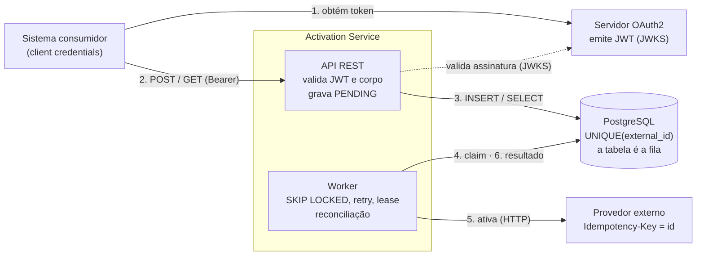
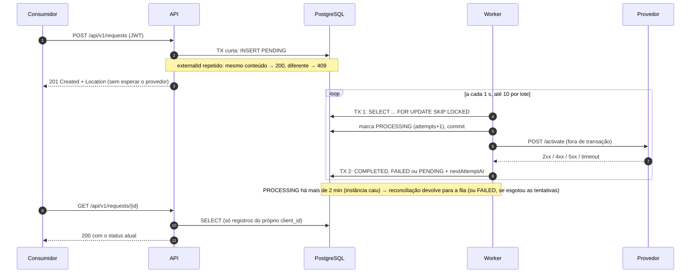

# Activation Service

Serviço de ativação de produtos de clientes. Ele registra solicitações, permite consultar o status e realiza a ativação por meio de um provedor externo.

**Stack:** Java 21 · Spring Boot 3.5 (Spring MVC, Spring Data JPA/Hibernate, Spring Security) · PostgreSQL 16 · Flyway · Maven · Docker.
**Testes:** 165 testes com JUnit 5, Mockito, AssertJ, MockMvc, Testcontainers, WireMock, Awaitility e ArchUnit. A cobertura é de 100% das linhas e dos ramos, exigida pelo build.

| Documento | Conteúdo |
|---|---|
| [docs/spec/requirements.md](docs/spec/requirements.md) | Requisitos com critérios de aceite numerados (R1–R10) |
| [docs/spec/design.md](docs/spec/design.md) | Design detalhado: modelo, esquema, fluxos, segurança, testes |
| [docs/spec/tasks.md](docs/spec/tasks.md) | Plano de implementação, rastreável até os commits |
| [docs/adr/](docs/adr) | Registros de decisão (ADR-0001 a 0004) |
| [Manual do Desenvolvedor](docs/guias/Manual-do-Desenvolvedor-Activation-Service.pdf) | Visão técnica para avaliação: como rodar, mapa do desafio para a solução, arquitetura, decisões e testes |
| [Guia de QA](docs/guias/Guia-QA-Activation-Service.pdf) | Estratégia de teste baseada em risco, 62 casos manuais priorizados, testes exploratórios e rastreabilidade com a automação |
| [Guia de uso pelo Swagger](docs/guias/Guia-Swagger-Activation-Service.pdf) | Passo a passo para quem vai usar a API pelo navegador |
| [Guia de uso pelo Postman](docs/guias/Guia-Postman-Activation-Service.pdf) | Passo a passo com a coleção Postman |

---

## Sumário

1. [Arquitetura](#arquitetura)
2. [Como executar](#como-executar)
3. [API](#api)
4. [Decisões técnicas](#decisões-técnicas)
5. [Estratégia de testes](#estratégia-de-testes)
6. [Cenário de análise (item 10)](#cenário-de-análise-item-10)
7. [Produção](#produção)
8. [Microsserviços e cloud](#microsserviços-e-cloud)
9. [Pontos pendentes](#pontos-pendentes)
10. [Melhorias futuras](#melhorias-futuras)
11. [Uso de IA](#uso-de-ia)

---

## Arquitetura

### Componentes



A API e o worker nunca se chamam diretamente: eles se comunicam pelo banco. A API só grava e lê; o worker busca o trabalho pendente, chama o provedor e grava o resultado. Por isso a solução funciona com qualquer número de instâncias, sem estado em memória compartilhado e sem broker adicional ([ADR-0001](docs/adr/0001-async-processing-with-table-as-queue.md)).

### Fluxo de uma solicitação



Pontos do desenho:

- **Resposta rápida:** o `POST` só grava e responde. A latência do provedor não afeta o consumidor.
- **Nenhuma transação aberta durante a chamada HTTP:** o claim (TX 1) e a gravação do resultado (TX 2) são curtos. Um provedor lento não segura conexões do pool nem locks.
- **Falhas:** 2xx → `COMPLETED`; `401`/`403` → volta para a fila sem gastar tentativa (a credencial errada é nossa, não do pedido); demais 4xx → `FAILED`; 408, 429, 5xx e timeout → nova tentativa (429 e 503 respeitam `Retry-After`) com backoff exponencial e jitter, até 5 tentativas ([ADR-0003](docs/adr/0003-retry-policy-and-failure-semantics.md)).
- **Entrega *at-least-once*:** se a instância cair no meio, a reconciliação devolve o registro para a fila. A `Idempotency-Key` evita ativação duplicada no provedor.

O detalhamento de cada etapa está em [docs/spec/design.md](docs/spec/design.md).

---

## Como executar

**Pré-requisitos:** JDK 21 e Docker em execução. Os testes de integração usam Testcontainers.

```bash
git clone https://github.com/Luigicuri/luigicuri-activation-service.git
cd luigicuri-activation-service
```

### Testes

Executa os testes unitários, os de integração (PostgreSQL real + WireMock) e as regras de arquitetura, e verifica a cobertura. O relatório fica em `target/site/jacoco/index.html`:

```bash
./mvnw verify
```

### Aplicação completa com Docker Compose

```bash
docker compose up --build
```

O comando sobe quatro containers:

| Serviço | Porta no host | Papel |
|---|---|---|
| `app` | `18080` (API e Swagger UI) e `18081` (Actuator) | O serviço |
| `postgres` | apenas rede interna | Banco de dados |
| `provider-mock` | `18089` | Provedor externo simulado (WireMock) |
| `auth` | `18090` | Servidor OAuth 2.0 simulado (mock-oauth2-server), que emite JWTs reais |

> As portas do host ficam na faixa 18xxx porque, no Windows, a faixa 8069–8268 costuma estar reservada pelo Hyper-V. Elas podem ser trocadas com `APP_PORT`, `MANAGEMENT_PORT`, `PROVIDER_PORT` e `AUTH_PORT`.

### Usando pelo navegador (Swagger UI)

Com a stack no ar, abra **http://localhost:18080/swagger-ui.html**:

1. Clique em **Authorize**. O `client_id` e o `client_secret` de demonstração já vêm preenchidos. Marque os escopos em **select all** e clique em **Authorize**. O próprio navegador obtém um token OAuth2 real do servidor simulado.
2. Abra uma operação (por exemplo, `POST /api/v1/requests`), clique em **Try it out**, ajuste o corpo e clique em **Execute**.
3. Copie o `id` da resposta e consulte em `GET /api/v1/requests/{id}`. Cerca de 1 s depois, o status é `COMPLETED`.

A especificação OpenAPI fica em `/v3/api-docs`. A documentação é pública, mas toda operação exige token. Em produção, ela pode ser desligada com `SPRINGDOC_SWAGGER_UI_ENABLED=false`.

### Usando pelo Postman

Importe a coleção [docs/postman/activation-service.postman_collection.json](docs/postman/activation-service.postman_collection.json): 16 requisições em 4 pastas (criar, consultar, listar e permissões), cada uma com a verificação do resultado esperado. O login já vem configurado: na coleção, aba **Authorization** → **Get New Access Token** → **Use Token**. A pasta 4 tem login próprio, de um cliente só leitura. A coleção foi validada com o Newman contra a stack do compose.

### Chamando a API

**1. Obter um token (fluxo *client credentials*):**

```bash
TOKEN=$(curl -s -X POST localhost:18090/default/token \
  -d grant_type=client_credentials -d client_id=orders-system -d client_secret=secret \
  -d "scope=activation:read activation:write" | grep -o '"access_token" *: *"[^"]*"' | cut -d'"' -f4)
```

**2. Criar uma solicitação:**

```bash
curl -i -X POST localhost:18080/api/v1/requests \
  -H "Authorization: Bearer $TOKEN" -H "Content-Type: application/json" \
  -H "X-Correlation-Id: demo-1" \
  -d '{"externalId":"EXT-12345","customerId":"CUST-10001","productCode":"INTERNET-500"}'
```

**3. Consultar (o status passa de `PENDING` a `COMPLETED` em cerca de 1 s):**

```bash
curl -s localhost:18080/api/v1/requests/<id> -H "Authorization: Bearer $TOKEN"
curl -s "localhost:18080/api/v1/requests?status=COMPLETED&page=0&size=20" -H "Authorization: Bearer $TOKEN"
```

**Cenários do provedor simulado**, escolhidos pelo `productCode` (ver [docker/wiremock/mappings](docker/wiremock/mappings)):

| `productCode` | Resposta do provedor | Resultado esperado |
|---|---|---|
| qualquer outro | `200` | `COMPLETED` |
| `INVALID-PRODUCT` | `400` | `FAILED`, sem nova tentativa |
| `UNAVAILABLE-PRODUCT` | `503` + `Retry-After: 5` | Novas tentativas a cada ~5 s; `FAILED` após 5 tentativas |
| `SLOW-PRODUCT` | `200` após 8 s (acima do timeout de 5 s) | Timeouts e novas tentativas; `FAILED` após 5 tentativas |

**Observabilidade local:** `localhost:18081/actuator/health`, `/actuator/health/readiness` e `/actuator/prometheus`.

---

## API

| Método | Caminho | Escopo | Respostas |
|---|---|---|---|
| `POST` | `/api/v1/requests` | `activation:write` | `201` + `Location` (criada) · `200` (retry idempotente) · `400` · `409` · `413` |
| `GET` | `/api/v1/requests/{id}` | `activation:read` | `200` · `404` |
| `GET` | `/api/v1/requests?status=&customerId=&page=&size=` | `activation:read` | `200` (paginado) · `400` |

Todas as rotas também podem responder `401` (sem token ou token inválido) e `403` (escopo insuficiente).

**Validação de `externalId`, `customerId` e `productCode`:** obrigatórios, de 1 a 64 caracteres, contendo apenas letras, dígitos, `.`, `_` ou `-`.
**Paginação:** `page` ≥ 0 (padrão 0) e `size` entre 1 e 100 (padrão 20). Ordenação por `createdAt` decrescente.

**Índices que sustentam as consultas** (migração [V1](src/main/resources/db/migration/V1__create_activation_request.sql)):

| Índice | Atende | Justificativa |
|---|---|---|
| `UNIQUE (external_id)` | Duplicidade | Garante a unicidade e também serve à releitura do registro existente no fluxo de retry |
| `(client_id, created_at DESC)` | Listagem sem filtro | Toda listagem é filtrada pelo dono (isolamento entre clientes) e ordenada pela data; o índice entrega as linhas já na ordem. O `id`, usado só para desempatar registros do mesmo milissegundo, é resolvido pelo PostgreSQL com *incremental sort* sobre poucas linhas |
| `(client_id, status, created_at DESC)` | Filtro por `status` | Igualdade em `client_id` e `status`, seguida da ordenação |
| `(client_id, customer_id, created_at DESC)` | Filtro por `customerId` | Idem. Com os dois filtros, a expectativa é que o planejador escolha este, porque `customerId` costuma ser mais seletivo que `status`, e filtre o `status` no resultado. A escolha final é do planejador, conforme as estatísticas, e deve ser confirmada com `EXPLAIN` sobre dados reais |
| `(next_attempt_at) WHERE status = 'PENDING'` | Fila do worker | Índice **parcial**: contém só a fila, que é pequena; os registros finalizados, que são a maioria, ficam de fora |
| `(processing_started_at) WHERE status = 'PROCESSING'` | Reconciliação | Mesmo raciocínio: só os registros em andamento |

Os índices compostos começam por `client_id` porque nenhuma consulta da API acontece sem ele. Um índice só em `status` teria baixa seletividade (quatro valores) e não ajudaria a ordenação.
**Datas:** UTC, ISO-8601 (ex.: `2026-10-26T14:03:11.123Z`).

**Erros** seguem o RFC 9457 (`application/problem+json`) e trazem um `traceId` igual ao dos logs:

```json
{
  "type": "https://api.luigicuri.dev/problems/validation-error",
  "title": "Invalid data",
  "status": 400,
  "detail": "One or more fields failed validation.",
  "instance": "/api/v1/requests",
  "traceId": "4bf92f3577b34da6a3ce929d0e0e4736",
  "errors": [{ "field": "customerId", "message": "is required" }]
}
```

> As mensagens estão em inglês, por consistência com o código e para não depender do idioma da JVM: sem mensagens explícitas, o Bean Validation responderia em português numa máquina e em inglês no container.

---

## Decisões técnicas

### Organização do código

Um pacote por funcionalidade, com camadas leves dentro dele. Não usei ports & adapters formal, porque o enunciado pede para não exagerar. As regras de dependência são verificadas pelo [ArchitectureTest](src/test/java/com/luigicuri/activation/ArchitectureTest.java).

```
com.luigicuri.activation
├── request/
│   ├── api/          controller, DTOs (records)
│   ├── application/  casos de uso: criar, consultar, listar
│   ├── domain/       entidade, estados e transições
│   ├── persistence/  repositório Spring Data, queries de fila
│   └── processing/   worker, política de retry, reconciliação
├── provider/         cliente HTTP do provedor e classificação das respostas
└── shared/           erros (ProblemDetail), segurança, correlação, filtros web
```

### Estados e transições

```
PENDING ──▶ PROCESSING ──▶ COMPLETED
   ▲             │
   └─ retry ─────┴────────▶ FAILED
```

As transições são feitas por métodos do domínio (`startProcessing`, `complete`, `scheduleRetry`, `postpone`, `fail`), que rejeitam qualquer outra combinação. Não existem setters de status. `@Version` protege contra escrita concorrente.

**Falha temporária volta para `PENDING`** com `attempts++` e `nextAttemptAt`, em vez de permanecer em `PROCESSING` com um contador. Assim, `PROCESSING` significa apenas "uma instância está chamando o provedor agora", e um `PROCESSING` antigo é sempre uma anomalia (a instância caiu), tratada pela reconciliação ([ADR-0003](docs/adr/0003-retry-policy-and-failure-semantics.md)).

### Duplicidade (item 3), [ADR-0002](docs/adr/0002-duplicate-prevention-with-unique-constraint.md)

**Estratégia:** uma constraint `UNIQUE (external_id)` no PostgreSQL é a única fonte de verdade. O serviço tenta o `INSERT` direto. Se a violação for **dessa** constraint, ele relê o registro existente numa transação nova e decide a resposta.

**Por que verificar se existe e depois inserir não basta:** duas requisições simultâneas executam o `SELECT` ao mesmo tempo, as duas não encontram nada e as duas inserem. Só o banco enxerga as duas transações ao mesmo tempo, e nenhum lock em memória funciona com mais de uma instância. O teste [DuplicateRequestConcurrencyIT](src/test/java/com/luigicuri/activation/request/application/DuplicateRequestConcurrencyIT.java) dispara 20 requisições idênticas em paralelo contra o PostgreSQL real e confirma que existe exatamente um registro.

| Cenário | Resposta | Justificativa |
|---|---|---|
| Mesmo `externalId`, mesmo conteúdo (retry) | `200` com o registro existente | O retry é legítimo e deve ser idempotente. Um `409` obrigaria o cliente a tratar um erro como sucesso. O `200` (e não `201`) indica que nada novo foi criado |
| Mesmo `externalId`, conteúdo diferente | `409` + mensagem indicando o conflito | Provável erro do sistema de origem, que reutilizou a chave. Aceitar mascararia o problema |
| Mesmo `externalId` usado por outro sistema consumidor | `409` genérico, sem dados | Não revela o registro de outro dono (BOLA) |
| Duas requisições idênticas em paralelo | Uma recebe `201` e a outra `200`, com o mesmo `id` | Consequência direta das regras acima |

### Integração com o provedor (item 5), [ADR-0001](docs/adr/0001-async-processing-with-table-as-queue.md) e [ADR-0003](docs/adr/0003-retry-policy-and-failure-semantics.md)

**Processamento assíncrono, usando a própria tabela como fila.** O `POST` grava a solicitação como `PENDING` e responde imediatamente. Um worker agendado:

1. Numa transação curta, seleciona os `PENDING` vencidos com `FOR UPDATE SKIP LOCKED`, marca-os como `PROCESSING` e faz commit.
2. Chama o provedor **sem nenhuma transação aberta**.
3. Numa segunda transação curta, grava o resultado.

| Retorno do provedor | Novo status | Nova tentativa? | Justificativa |
|---|---|---|---|
| `2xx` | `COMPLETED` | — | Ativação confirmada |
| `400` (e demais `4xx`, exceto `401`/`403`) | `FAILED` | Não | O pedido em si foi rejeitado; repetir não muda o resultado |
| `401` / `403` | `PENDING` | Sim, a cada 1 min, **sem gastar tentativa** | A credencial recusada é a **nossa**: o problema é de configuração, não do pedido. Marcar `FAILED` perderia todas as solicitações do período; elas aguardam a correção e são concluídas depois dela. Cada recusa gera log `ERROR` e a métrica `activation.provider.calls{outcome=credentials_rejected}`, que deve ter alerta; a fila parada aparece em `activation.requests.active{status=PENDING}` |
| `500` (e `408`, demais `5xx`) | `PENDING` | Sim, com backoff exponencial e jitter | Falha provavelmente passageira |
| Timeout / erro de conexão | `PENDING` | Sim, com backoff | O resultado é desconhecido. É seguro repetir porque a `Idempotency-Key` impede a ativação duplicada |
| `429` / `503` com `Retry-After` | `PENDING` | Sim, no momento indicado pelo provedor (limitado ao teto de 5 min do backoff) | O provedor diz quando voltar |
| Limite de tentativas (5) atingido | `FAILED` | Não | Evita retry infinito; o `failureReason` registra o último erro |

**Por que assíncrono:** o tempo de resposta da API deixa de depender do provedor. No cenário do item 10, o provedor passa de 400 ms para 3 s. Num fluxo síncrono, isso prenderia threads e conexões da API inteira.

**Garantia de envio mesmo se a aplicação cair entre o commit e a chamada:** a solicitação gravada **é** o trabalho pendente. Qualquer instância a encontra no próximo ciclo do worker. Se a instância cair *durante* a chamada, o registro fica `PROCESSING` até o lease (2 min) vencer, e então a reconciliação o devolve para a fila. A entrega é *at-least-once*.

**Timeout ambíguo e duplicidade no provedor:** toda chamada envia `Idempotency-Key` igual ao `id` da solicitação. O retry depois de um timeout reenvia a mesma chave, e o provedor, se for idempotente, devolve o resultado original sem ativar de novo.

**Resultado atrasado:** cada claim leva o número da tentativa. Uma resposta que chega depois que o lease venceu e a solicitação foi reprocessada é descartada, em vez de sobrescrever o resultado mais recente.

**Várias instâncias:** o `SKIP LOCKED` faz cada instância pegar um lote diferente, sem bloqueio entre elas. Há teste provando isso.

**Timeouts explícitos:** conexão de 2 s e leitura de 5 s, configuráveis (`provider.connect-timeout` e `provider.read-timeout`).

**Erro de integração no consumidor da API:** como o processamento é assíncrono, uma falha do provedor nunca vira erro HTTP na criação. Ela aparece no `GET` (`status: FAILED` com `failureReason`), nos logs e nas métricas.

**Resiliência:** não implementei circuit breaker. O backoff persistido no banco já reduz a pressão sobre um provedor degradado (ver [Pontos pendentes](#pontos-pendentes)).

### Tratamento de erros (item 6)

Um único `@RestControllerAdvice` converte tudo para ProblemDetail, inclusive os erros que o próprio Spring MVC gera (405, 415) e os de segurança (401/403, via handlers próprios).

| Situação | Status |
|---|---|
| Dados inválidos, JSON malformado, parâmetro inválido | `400` |
| Registro inexistente (inclusive de outro dono) | `404` |
| Duplicidade | `409` |
| Corpo acima de 16 KB | `413` |
| Erro inesperado | `500` com mensagem genérica. Stack trace, SQL e nomes de classe aparecem só no log, com o mesmo `traceId` |
| Erro do provedor | Refletido no status da solicitação (ver acima) |

### Segurança (item 7, implementada), [ADR-0004](docs/adr/0004-oauth2-resource-server-with-client-isolation.md)

- **Fluxo OAuth 2.0 Client Credentials:** é o fluxo feito para comunicação entre sistemas, sem usuário humano envolvido.
- **Resource Server com JWT:** valida assinatura (chaves do JWKS do emissor, com cache e suporte a rotação), `iss`, `exp`/`nbf` e `aud = activation-service`. A validação de audiência impede que um token emitido para outra API da empresa seja aceito aqui. O [JwtValidationIT](src/test/java/com/luigicuri/activation/shared/security/JwtValidationIT.java) assina tokens reais e prova que tokens expirados, com outra audiência, de outro emissor ou com assinatura forjada são recusados.
- **Escopos:** `activation:write` para criar e `activation:read` para consultar.
- **Isolamento entre consumidores (OWASP API1, BOLA):** cada solicitação guarda o `client_id` do token que a criou, e toda consulta filtra por ele. A solicitação de outro sistema responde `404`, e não `403`, para não confirmar que o `id` existe.
- **Limites:** corpo da requisição limitado a 16 KB (`413`), inclusive em requisições *chunked*. O rate limiting fica a cargo do API Gateway (ver [Produção](#produção)).
- **API stateless:** sem sessão. O CSRF fica desligado porque a autenticação é por bearer token, sem cookies.
- **Credencial para chamar o provedor:** fica fora do código e da imagem, lida da variável `PROVIDER_API_KEY`, que em produção é injetada a partir de um cofre (Azure Key Vault ou AWS Secrets Manager). A rotação é feita no cofre, com duas credenciais válidas durante a janela de troca e reinício gradual dos pods (ou recarga via Spring Cloud). A credencial nunca é registrada em log. A evolução natural é trocar a chave estática por OAuth client credentials também na chamada ao provedor.

### Observabilidade

- **Actuator** na porta de gestão `8081`, separada da API: `liveness`, `readiness` (que inclui o banco) e `prometheus`.
- **Métricas:**
  - `activation.provider.calls`: latência e taxa de erro do provedor, por resultado;
  - `activation.requests.transitions`: transições por status resultante;
  - `activation.requests.active`: quantas solicitações estão agora em `PENDING` e em `PROCESSING` (tamanho da fila), contadas a cada coleta pelos índices parciais;
  - histogramas de `http.server.requests` e `http.client.requests`.
- **Correlação:** o `X-Correlation-Id` é aceito (validado contra *log injection*) ou gerado, vai para o MDC como `traceId`, volta no header da resposta e nos erros, fica **persistido com a solicitação** e é restaurado pelo worker e enviado ao provedor. Dá para seguir uma ativação do `POST` até a chamada externa por um único identificador.
- **Logs em JSON** (formato ECS) no profile `docker`. Nenhum token ou credencial é registrado.

### Outras escolhas

| Escolha | Motivo |
|---|---|
| Spring Boot **3.5** | Linha 3.x pedida no enunciado (provável stack da empresa). O suporte OSS da 3.5 terminou em jun/2026; a migração para a 4.x está em [Melhorias futuras](#melhorias-futuras) |
| `RestClient` sobre o `HttpClient` do JDK | Cliente síncrono e moderno com timeouts explícitos, sem trazer WebFlux |
| PostgreSQL também nos testes (Testcontainers), e não H2 | Constraint única, `SKIP LOCKED` e `TIMESTAMPTZ` se comportam diferente no H2, o que daria falsa confiança |
| `open-in-view: false` | Nenhuma conexão de banco fica presa durante a renderização da resposta |
| Relógio injetável, com precisão de milissegundos | Testes determinísticos. O `createdAt` devolvido no `POST` é idêntico ao lido no `GET` (o PostgreSQL arredonda frações menores que microssegundos) |

---

## Estratégia de testes

| Nível | O que cobre | Ferramentas |
|---|---|---|
| **Unitário (sem Spring)** | Transições de estado, política de retry e jitter, classificação das respostas do provedor, parsing de `Retry-After`, limite de corpo *chunked* | JUnit, AssertJ |
| **Unitário com mocks** | Os ramos de decisão da duplicidade | Mockito |
| **Slice web** | Contrato HTTP, validação, formato do ProblemDetail, 401/403/413, correlação | `@WebMvcTest`, MockMvc, `jwt()` |
| **Integração** | Fluxo completo com PostgreSQL real: criação e consulta, duplicidade concorrente, listagem, isolamento entre clientes, todos os cenários do provedor (sucesso, 400, 500→sucesso, timeout, 429, limite de tentativas), prova do `SKIP LOCKED`, reconciliação, resultado atrasado, validação real de JWT | `@SpringBootTest`, Testcontainers, WireMock, Awaitility |
| **Arquitetura** | Dependências entre pacotes, sem ciclos | ArchUnit |

- O worker fica **desligado** nos testes de integração e é chamado diretamente, um ciclo por vez. Assim cada cenário é determinístico. Um único teste ([ScheduledProcessingIT](src/test/java/com/luigicuri/activation/request/processing/ScheduledProcessingIT.java)) liga o agendador real e valida o fluxo de ponta a ponta com Awaitility.
- **Cobertura:** o JaCoCo mede os testes unitários e de integração juntos, e o `./mvnw verify` **falha** abaixo de 100% de linhas e de ramos. A única exclusão é o `main()`, que só chama `SpringApplication.run`. Ao fechar as lacunas, em vez de criar testes só para executar linhas, removi código defensivo que nunca podia ser atingido, e os testes novos encontraram um bug real: `fail(null)` alterava o status antes de lançar a exceção.
- O objetivo não é o número em si, e sim que cada critério de aceite da [spec](docs/spec/requirements.md) tenha um teste que falhe se o comportamento mudar. O gate de 100% garante que nenhum código novo entre sem teste.

---

## Cenário de análise (item 10)

> Tempo médio da API: 300 ms → 2,5 s · CPU 45% · Memória 60% · Algumas consultas: 50 ms → 1,2 s · Serviço externo: 400 ms → 3 s

**O que eu investigaria primeiro.** CPU e memória estão normais. Então a aplicação não está trabalhando mais, ela está **esperando** por alguma coisa. Eu começaria pelos recursos que podem estar sendo esperados:

- o pool de conexões do banco (HikariCP);
- o pool de threads do Tomcat;
- o tempo do provedor.

Também olharia o que mudou na época: deploy, volume de dados, volume de tráfego, mudança no provedor.

**Como separar aplicação, banco e integração.**
- **Banco:** comparo o tempo que a aplicação mede para a consulta com o tempo que o próprio banco mede (`pg_stat_statements`). Se o banco executa em 50 ms e a aplicação percebe 1,2 s, o tempo está na **espera por conexão**, não na consulta. Se o banco também mede 1,2 s, o problema é no banco: rodo `EXPLAIN (ANALYZE, BUFFERS)` para procurar índice faltando, crescimento de tabela ou estatísticas desatualizadas, e confiro `pg_stat_activity` para ver locks e sessões `idle in transaction`.
- **Integração:** a métrica de latência do cliente HTTP (`http.client.requests` / `activation.provider.calls`) isola o provedor. Se ela subiu sozinha, o problema começa fora da aplicação.
- **Aplicação:** um *thread dump* mostra onde as threads estão paradas. Se estiverem todas lendo socket do provedor ou esperando conexão do Hikari, ele já aponta a causa.

**Logs e métricas úteis.**
- Percentis p95/p99 por endpoint (`http.server.requests`), e não só a média.
- `hikaricp_connections_active`, `_pending` e `_acquire` (tempo para obter conexão).
- Threads ocupadas do Tomcat.
- Latência e taxa de erro do provedor.
- Tempo de execução no banco (`pg_stat_statements`).
- Logs com `traceId` para seguir uma requisição lenta de ponta a ponta. Com tracing distribuído (OpenTelemetry), daria para ver em qual *span* o tempo foi gasto.

**Os três sintomas podem ter uma causa comum? Minha hipótese é que sim.** Se a chamada ao provedor fosse **síncrona e acontecesse dentro de uma transação** (ou com `open-in-view` ligado), cada requisição seguraria uma conexão do banco por todo o tempo da chamada externa. Com o provedor passando de 400 ms para 3 s, cada conexão fica presa cerca de 7 vezes mais. O pool de conexões esgota, e as consultas rápidas passam a esperar na fila do Hikari. Elas **parecem** lentas (1,2 s), mas o banco continua executando em 50 ms. Threads esperando também não consomem CPU, o que explica 45% de CPU com 2,5 s de latência. Para confirmar:

- `hikaricp_connections_pending` alto e `acquire` alto;
- o banco medindo 50 ms em `pg_stat_statements` enquanto a aplicação mede 1,2 s;
- *thread dump* com threads paradas em leitura de socket do provedor ou em `HikariPool.getConnection`;
- correlação temporal: os três gráficos sobem juntos com a latência do provedor.

**Melhorias possíveis.**
- **Estruturais**, já aplicadas neste projeto: chamada ao provedor fora de transação, processamento assíncrono (a API não espera o provedor), `open-in-view` desligado e timeouts explícitos.
- **Táticas:** circuit breaker para não acumular chamadas num provedor degradado; *bulkhead* (pool separado para chamadas externas); dimensionar o Hikari com base em medição; índices para as consultas lentas, se o banco confirmar lentidão real; cache de leituras frequentes, se fizer sentido.

**Como validar a correção depois de publicada.**
- Comparo p95/p99 e as métricas do Hikari antes e depois, com o mesmo perfil de tráfego.
- Publico primeiro como *canary* para uma fração do tráfego e acompanho os alertas de SLO (por exemplo, "p99 < 500 ms").
- Antes de publicar, reproduzo o cenário num teste de carga com o provedor simulado lento (os mocks com atraso do compose servem para isso). A correção só está validada se a latência da API permanecer estável mesmo com o provedor a 3 s.

---

## Produção

Como eu executaria o serviço:

- **Imagem:** o `Dockerfile` multi-stage gera uma imagem JRE enxuta, com usuário não-root, heap proporcional ao limite do container (`MaxRAMPercentage`) e health check. O CI faz o build. Na entrega contínua, a imagem é publicada num registry (ACR/ECR), com tag pelo SHA do commit e scan de vulnerabilidades.
- **Execução:** em orquestrador de containers (AKS/EKS ou Azure Container Apps), com **2+ réplicas**:
  - probes de `liveness` e `readiness` na porta de gestão;
  - `requests/limits` de CPU e memória definidos;
  - desligamento gracioso, em que o Spring espera as requisições em andamento e o agendador espera a chamada em curso ao provedor.
- **Configuração e segredos:** só por variáveis de ambiente (`DB_URL`, `PROVIDER_BASE_URL`, `JWT_ISSUER_URI` etc.). Os segredos (`DB_PASSWORD`, `PROVIDER_API_KEY`) vêm do cofre do provedor cloud, via CSI driver ou integração nativa, e nunca ficam no repositório nem na imagem.
- **Banco:** PostgreSQL gerenciado (Azure Database for PostgreSQL / RDS), com backups e réplica. As migrações do Flyway rodam na subida; com muitas réplicas, eu as rodaria num *job* separado antes do deploy.
- **Borda:** um API Gateway faz TLS, rate limiting por `client_id` e limites de tamanho. Atrás dele, a aplicação precisa de `server.forward-headers-strategy=framework` para que o header `Location` aponte para o host público, e não para o interno. A porta de gestão `8081` não é exposta publicamente, só para o orquestrador e o Prometheus.
- **Observabilidade:**
  - Prometheus + Grafana com dashboards de latência da API e do provedor, status das solicitações e pool de conexões;
  - logs JSON centralizados (ELK/Loki ou Azure Monitor);
  - alertas para p99, taxa de `FAILED`, recusas de credencial (`outcome=credentials_rejected`), fila `PENDING` crescendo e `PROCESSING` que não esvazia (`activation.requests.active`).
- **Escala do worker:** a propriedade `activation.processing.enabled` permite separar instâncias só de API e instâncias só de processamento, se as cargas crescerem de forma diferente.

---

## Microsserviços e cloud

- **Várias instâncias sem quebrar as regras:** a duplicidade é garantida pela constraint do banco, independente do número de instâncias. O processamento usa `SKIP LOCKED`, então cada instância pega um lote diferente, e a reconciliação recupera o trabalho de uma instância que caiu. Não há estado em memória que precise ser compartilhado.
- **Configurações e segredos:** variáveis de ambiente para configuração; cofre de segredos do provedor cloud (Key Vault / Secrets Manager) para credenciais, com rotação no cofre.
- **Avisar outros serviços de que uma ativação foi concluída:** com o padrão **transactional outbox**:
  - na mesma transação que marca `COMPLETED`/`FAILED`, grava um evento `ActivationCompleted`/`ActivationFailed` numa tabela de outbox;
  - um publicador (ou Debezium/CDC) envia os eventos para um tópico Kafka;
  - os consumidores tratam o evento de forma idempotente (pelo `id` do evento).
  Assim não existe o caso de "gravou mas não publicou", nem o contrário.
- **Pipeline de CI/CD:**
  - **CI** (já implementado em [.github/workflows/ci.yml](.github/workflows/ci.yml)): `./mvnw verify` (unitários, integração, arquitetura e gate de cobertura de 100%) e build da imagem.
  - **Etapas seguintes:** análise estática e de dependências (SonarQube, Snyk); publicação da imagem no registry com a tag do commit; deploy automático em homologação; testes de fumaça; promoção para produção com aprovação, deploy *rolling* ou *canary* e rollback automático se os alertas dispararem.

---

## Pontos pendentes

O que não foi implementado, e como eu faria:

| Item | Como faria |
|---|---|
| Notificar outros serviços sobre a conclusão | Transactional outbox + Kafka, como descrito acima |
| Circuit breaker | Resilience4j em volta do `ProviderClient`. Com o circuito aberto, o resultado é tratado como falha transitória e o retry é adiado, sem gastar tentativas |
| Rate limiting | No API Gateway, por `client_id`. Dentro da aplicação, só se não houver gateway (por exemplo, Bucket4j) |
| Tracing distribuído | OpenTelemetry (Micrometer Tracing + exporter OTLP). O `traceId` atual já é propagado, mas sem *spans* |
| Reprocessar solicitações `FAILED` | Endpoint administrativo, com escopo próprio e auditoria, que devolve a solicitação para `PENDING` |
| Unicidade de `externalId` por sistema consumidor | Hoje a unicidade é global, seguindo o enunciado. Se cada sistema de origem gerar suas próprias chaves, a constraint deveria ser `UNIQUE (client_id, external_id)` |
| URIs dos tipos de problema | `https://api.luigicuri.dev/problems/...` são identificadores estáveis, mas não apontam para páginas publicadas |
| Resposta quando o banco cai | Hoje o `POST` espera até 30 s (tempo padrão do pool de conexões) e responde `500` genérico. Reduziria `spring.datasource.hikari.connection-timeout` para poucos segundos e mapearia a falta de conexão para `503` com `Retry-After`, mais útil para o cliente |
| Contrato de idempotência com o provedor | A solução assume que o provedor respeita `Idempotency-Key`. Isso precisa estar acordado e testado com ele |
| Pausa global com credencial recusada | Com `401`/`403`, cada solicitação é adiada em 1 min sem gastar tentativa, mas o worker ainda faz uma chamada por solicitação a cada minuto. Um circuit breaker pausaria o processamento inteiro até a credencial ser corrigida. Se o contrato do provedor usar `403` para recusas de negócio, esse código deve voltar para a regra de `FAILED` |
| `FAILED` depois de esgotar as tentativas por timeout | Depois de um timeout, o resultado no provedor é desconhecido: ele pode ter ativado. Hoje o status fica `FAILED`, com o motivo em `failureReason`. Com um endpoint de consulta no provedor, eu confirmaria o estado pela `Idempotency-Key` antes de declarar a falha, ou usaria um status próprio (por exemplo, `UNKNOWN`) para tratamento manual |
| Vazão do worker | Cada instância chama o provedor uma solicitação por vez. Com o provedor a 3 s (cenário do item 10), são cerca de 20 ativações por minuto por instância. A latência da API não é afetada, mas a fila cresce. Escalaria com mais instâncias (o `SKIP LOCKED` já permite) ou com chamadas paralelas limitadas dentro do lote (por exemplo, virtual threads com semáforo), recalculando o lease |
| Paginação por offset | Cada página executa também um `count(*)`, e páginas profundas ficam caras. Para volumes grandes, trocaria por paginação por cursor (`createdAt`, `id`), que os índices já suportam |

---

## Melhorias futuras

- **Migrar para Spring Boot 4.x** (Spring Framework 7, Jackson 3, Hibernate 7). O suporte OSS da 3.5 já terminou.
- **Retenção de dados:** arquivar ou particionar as solicitações finalizadas por data. Os índices parciais já mantêm a fila pequena, mas a tabela cresce sem limite.
- **Webhook ou evento para o consumidor**, em vez de exigir polling no `GET`.
- **Versionamento da API** e publicação da especificação OpenAPI (já gerada em `/v3/api-docs`) pelo pipeline.
- **Testes de carga** (Gatling/k6) no pipeline, com o provedor simulado lento, para proteger contra regressões do tipo do item 10.
- **Dashboards e alertas versionados** junto com o código (Grafana como código).

---

## Uso de IA

O projeto foi desenvolvido com o **Claude Code** (Claude Opus 5.5, da Anthropic) como ferramenta, dentro de um processo de **Spec-Driven Development (SDD)**. A IA aumentou a velocidade de execução; o processo é o que garantiu o controle sobre as decisões e a qualidade do resultado.

### Por que Spec-Driven Development

O maior risco de desenvolver com IA é gerar código antes de decidir *o que* construir e *por quê*: o resultado funciona, mas ninguém escolheu de fato os trade-offs. No SDD a especificação vem antes do código e é a fonte da verdade. Cada decisão fica explícita, revisável antes da implementação e rastreável até o teste que a comprova.

### Como o trabalho foi conduzido

1. **Análise:** leitura do enunciado e dos requisitos da vaga; separação entre obrigatórios e diferenciais; definição do que implementar e do que apenas descrever no README.
2. **Especificação** ([`docs/spec`](docs/spec) e [`docs/adr`](docs/adr)): requisitos R1–R10 com critérios de aceite numerados, design e plano de tarefas. Para cada decisão estrutural, as alternativas foram comparadas antes da escolha (ex.: processamento síncrono, `@Async` ou tabela como fila; `UNIQUE` com tratamento da violação, `ON CONFLICT` ou lock; segurança descrita ou implementada; Spring Boot 3.5 ou 4.x). A spec foi aprovada antes de qualquer linha de código.
3. **Implementação incremental:** cinco fases (fundação, domínio e API, integração, segurança, operação). Cada tarefa virou um ou mais commits pequenos que citam a tarefa do plano (ex.: `T3.3`); o [`tasks.md`](docs/spec/tasks.md) liga cada tarefa aos requisitos que ela atende. Cada fase terminou num **checkpoint de revisão**.
4. **Verificação:** testes automatizados como critério de pronto (165 testes, PostgreSQL real, gate de 100% de cobertura); execução real da stack com `docker compose`, pelo Swagger e pela coleção Postman (validada com Newman); revisões do resultado contra o enunciado.

### Divisão de papéis

| Responsabilidade | Desenvolvedor | IA (Claude Code) |
|---|---|---|
| Escopo e prioridades | Definiu | Propôs opções |
| Decisões técnicas e trade-offs | Escolheu entre as alternativas e aprovou | Levantou alternativas, prós e contras |
| Especificação e ADRs | Revisou e aprovou | Redigiu a partir das decisões |
| Código, testes e infraestrutura | Revisou a cada checkpoint | Implementou, tarefa por tarefa |
| Critérios de qualidade | Definiu (ex.: cobertura total, plano de QA, revisão contra o enunciado) | Executou e reportou o resultado |
| Validação final | Testou manualmente a aplicação | Rodou builds, testes e verificações |

### O que o processo encontrou

As revisões em checkpoint e contra o enunciado pegaram problemas que uma geração direta de código teria deixado passar:

- datas diferentes entre a resposta do `POST` e a do `GET` (precisão em memória × no banco);
- uma transição de estado que alterava a entidade antes de validar a entrada;
- um header malformado que resultava em `500` em vez de `400`;
- um ciclo de dependência entre pacotes, detectado pelo ArchUnit;
- a justificativa dos índices, pedida no README e registrada só no design.

As decisões foram registradas com contexto, alternativas e consequências.
