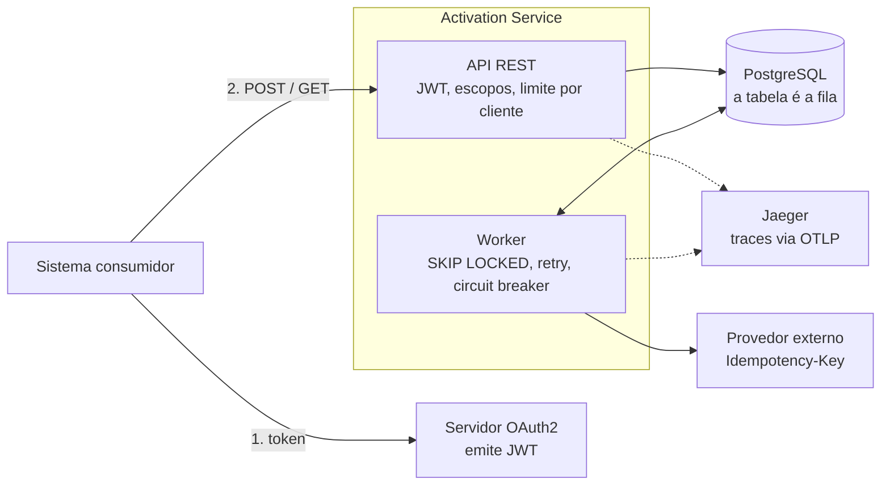
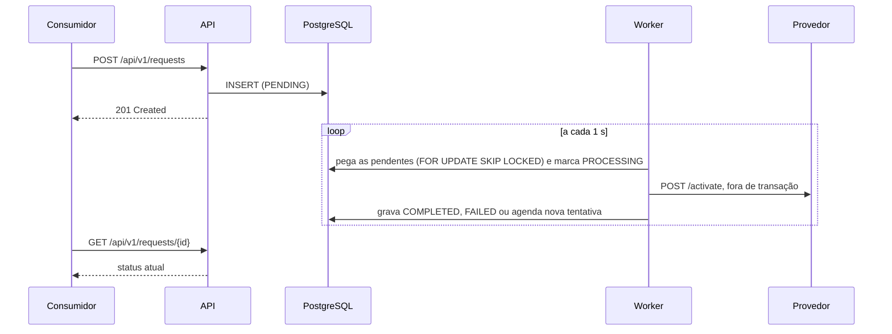

# Activation Service

Serviço que recebe solicitações de ativação de produtos, permite acompanhar o status de cada uma e faz a ativação por meio de um provedor externo.

**Stack:** Java 21 · Spring Boot 3.5 (MVC, Data JPA, Security) · PostgreSQL 16 · Flyway · Maven · Docker.

Este README resume as decisões. Os detalhes estão em:

- [`docs/spec`](docs/spec): requisitos, design e plano de tarefas;
- [`docs/adr`](docs/adr): as quatro decisões principais, com as alternativas que descartei;
- [`docs/guias`](docs/guias): Manual do Desenvolvedor, Guia de QA e guias de uso pelo Swagger e pelo Postman (PDF).

## Sumário

1. [Como executar](#como-executar)
2. [Como a solução funciona](#como-a-solução-funciona)
3. [Decisões técnicas](#decisões-técnicas)
4. [Testes](#testes)
5. [Cenário de análise (item 10)](#cenário-de-análise-item-10)
6. [Produção](#produção)
7. [Pontos pendentes](#pontos-pendentes)
8. [Melhorias futuras](#melhorias-futuras)
9. [Uso de IA](#uso-de-ia)

---

## Como executar

Pré-requisitos: JDK 21 e Docker em execução.

```bash
git clone https://github.com/Luigicuri/luigicuri-activation-service.git
cd luigicuri-activation-service

./mvnw verify               # testes unitários e de integração (PostgreSQL real via Testcontainers)
docker compose up --build   # aplicação, PostgreSQL, provedor e servidor OAuth2 simulados, e Jaeger
```

Com a stack no ar, o jeito mais simples de usar a API é pelo **Swagger UI**, em http://localhost:18080/swagger-ui.html: clique em **Authorize** (as credenciais de demonstração já vêm preenchidas), marque os escopos e execute as operações. Também há uma [coleção do Postman](docs/postman/activation-service.postman_collection.json) com os cenários prontos. Os traces de cada solicitação aparecem no **Jaeger**, em http://localhost:18686 (serviço `activation-service`).

Pelo terminal:

```bash
TOKEN=$(curl -s -X POST localhost:18090/default/token \
  -d grant_type=client_credentials -d client_id=orders-system -d client_secret=secret \
  -d "scope=activation:read activation:write" | grep -o '"access_token" *: *"[^"]*"' | cut -d'"' -f4)

curl -i -X POST localhost:18080/api/v1/requests \
  -H "Authorization: Bearer $TOKEN" -H "Content-Type: application/json" \
  -d '{"externalId":"EXT-12345","customerId":"CUST-10001","productCode":"INTERNET-500"}'

curl -s localhost:18080/api/v1/requests/<id> -H "Authorization: Bearer $TOKEN"
```

O provedor simulado responde conforme o `productCode`: `INVALID-PRODUCT` é recusado (400), `UNAVAILABLE-PRODUCT` fica indisponível (503 com `Retry-After`) e `SLOW-PRODUCT` passa do timeout. Qualquer outro é ativado. Depois de falhas seguidas (por exemplo, com `UNAVAILABLE-PRODUCT`), o circuit breaker pausa as chamadas por 30 s: uma solicitação nova criada nesse intervalo fica `PENDING` um pouco mais e é concluída em seguida.

> As portas ficam na faixa 18xxx porque, no Windows, a faixa 8069–8268 costuma estar reservada pelo Hyper-V. Dá para trocá-las com `APP_PORT`, `MANAGEMENT_PORT`, `PROVIDER_PORT`, `AUTH_PORT` e `JAEGER_PORT`.

---

## Como a solução funciona

| Método | Caminho | Escopo | Respostas |
|---|---|---|---|
| `POST` | `/api/v1/requests` | `activation:write` | `201` + `Location` · `200` (reenvio idêntico) · `400` · `409` · `413` |
| `GET` | `/api/v1/requests/{id}` | `activation:read` | `200` · `404` |
| `GET` | `/api/v1/requests?status=&customerId=&page=&size=` | `activation:read` | `200` paginado · `400` |

Os três campos são obrigatórios, com 1 a 64 caracteres: letras, números, `.`, `_` ou `-`. Datas em UTC (ISO-8601). Qualquer rota pode responder `401`, `403`, `429` (limite de chamadas) ou `503` (banco indisponível).

Os erros seguem o RFC 9457 (`application/problem+json`) e trazem o `traceId`, que leva ao trace no Jaeger e aos logs, e o `correlationId`, que o sistema consumidor pode enviar no header `X-Correlation-Id`.

Os componentes e quem fala com quem:



O `POST` só grava a solicitação como `PENDING` e responde na hora. Um worker agendado pega as pendentes, chama o provedor e grava o resultado:



A API e o worker não se chamam: eles conversam pelo banco. Por isso o serviço funciona com várias instâncias sem nenhuma coordenação extra.

---

## Decisões técnicas

### Duplicidade (item 3)

Uma constraint `UNIQUE (external_id)` no banco decide. O serviço tenta o `INSERT` direto e, se a violação for dessa constraint, relê o registro existente para escolher a resposta. Verificar antes e inserir depois não basta: duas requisições simultâneas passariam juntas pela verificação. Só o banco enxerga as duas ao mesmo tempo. Um teste dispara 20 requisições idênticas em paralelo contra o PostgreSQL real e confere que existe um único registro.

| Cenário | Resposta |
|---|---|
| Mesmo `externalId`, mesmo conteúdo | `200` com o registro existente: é um retry legítimo, e um erro obrigaria o cliente a tratá-lo como sucesso |
| Mesmo `externalId`, conteúdo diferente | `409` explicando o conflito: provavelmente a chave foi reutilizada por engano |
| `externalId` usado por outro sistema | `409` genérico, sem revelar o registro alheio |
| Duas requisições iguais em paralelo | Uma recebe `201` e a outra `200`, com o mesmo `id` |

Mais em [ADR-0002](docs/adr/0002-duplicate-prevention-with-unique-constraint.md).

### Integração com o provedor (item 5)

Escolhi o processamento **assíncrono**, usando a própria tabela como fila. Assim, a API responde rápido mesmo com o provedor lento, e uma solicitação gravada nunca se perde. Se a aplicação cair entre o commit e a chamada, outra instância encontra a solicitação no próximo ciclo. Se cair *durante* a chamada, a solicitação volta para a fila depois de 2 minutos. A chamada HTTP acontece fora de qualquer transação, para não prender conexões do banco.

| Retorno do provedor | Novo status | Nova tentativa? |
|---|---|---|
| `2xx` | `COMPLETED` | — |
| `400` e demais `4xx` | `FAILED` | Não: o pedido foi recusado, repetir não muda nada |
| `401` / `403` | `PENDING` | Sim, a cada 1 min e sem contar tentativa: a credencial recusada é a nossa, não o pedido |
| `500`, `408`, timeout | `PENDING` | Sim, com backoff exponencial e jitter |
| `429` / `503` | `PENDING` | Sim, no momento indicado pelo `Retry-After` |
| 5 tentativas esgotadas | `FAILED` | Não, e o motivo fica em `failureReason` |

Depois de um timeout, o provedor pode ter ativado mesmo sem responder. Por isso toda chamada envia `Idempotency-Key` igual ao `id` da solicitação: o retry repete a mesma chave e não gera ativação duplicada. Os timeouts são explícitos (2 s para conectar e 5 s para ler).

Um **circuit breaker** (Resilience4j) protege o provedor: se metade das últimas 10 chamadas falhar, o worker para de chamá-lo por 30 s e depois testa com uma chamada só. Enquanto o circuito está aberto, nenhuma solicitação é retirada da fila, então ninguém gasta tentativa durante uma queda. Contam como falha só os problemas do provedor (5xx, timeout, credencial recusada); um `400` é uma resposta saudável sobre um pedido ruim. Mais em [ADR-0001](docs/adr/0001-async-processing-with-table-as-queue.md) e [ADR-0003](docs/adr/0003-retry-policy-and-failure-semantics.md).

### Estados

`PENDING → PROCESSING → COMPLETED | FAILED`. As transições são métodos da entidade, sem setters, e recusam qualquer outro caminho. Uma falha temporária volta para `PENDING` com a data da próxima tentativa, em vez de ficar em `PROCESSING` com um contador. Assim, `PROCESSING` sempre significa "alguém está chamando o provedor agora". O `@Version` protege contra escrita concorrente.

### Segurança (item 7, implementada)

- OAuth 2.0 **client credentials**, o fluxo pensado para comunicação entre sistemas. O serviço valida o JWT: assinatura (chaves via JWKS), emissor, expiração e audiência.
- Escopos `activation:write` para criar e `activation:read` para consultar.
- Cada sistema só enxerga as solicitações que criou. A de outro sistema responde `404`, e não `403`, para não confirmar que o registro existe (OWASP API1, BOLA).
- O corpo da requisição é limitado a 16 KB, e cada sistema consumidor pode fazer até 50 chamadas por segundo (configurável). Acima disso, a resposta é `429` com `Retry-After`. O contador fica na memória de cada instância; o limite global continua sendo papel do API Gateway.
- A chave do provedor vem de variável de ambiente, alimentada por um cofre de segredos em produção, onde também é feita a rotação. Ela nunca aparece em log.

Mais em [ADR-0004](docs/adr/0004-oauth2-resource-server-with-client-isolation.md).

### Outras escolhas

- **Pacote por funcionalidade**, com camadas leves dentro dele, sem arquitetura hexagonal formal: o enunciado pede para não exagerar. As regras de dependência são verificadas com ArchUnit.
- **PostgreSQL também nos testes**, via Testcontainers. Constraint única, `SKIP LOCKED` e fuso horário se comportam diferente no H2.
- **Índices da listagem** começam por `client_id`, porque toda consulta é filtrada pelo dono, e terminam em `created_at DESC`, que é a ordenação: `(client_id, created_at)`, `(client_id, status, created_at)` e `(client_id, customer_id, created_at)`. A fila do worker usa índices parciais (`WHERE status = 'PENDING'`), que ficam pequenos mesmo com a tabela crescendo. A justificativa completa está no [design](docs/spec/design.md).
- **Observabilidade:** Actuator numa porta separada (liveness e readiness), métricas no Prometheus (latência e resultado das chamadas ao provedor, transições e tamanho da fila) e logs em JSON. O tracing usa OpenTelemetry e é exportado para o Jaeger. Como o processamento é assíncrono, a solicitação guarda o `traceparent` de quem a criou, e o worker continua esse trace: o `POST`, o processamento e a chamada ao provedor aparecem como um único trace, e todos os logs do caminho trazem o mesmo `traceId`.

---

## Testes

`./mvnw verify` roda tudo. A maior parte da confiança vem dos testes de integração, que usam o banco real e um provedor simulado com WireMock:

- **Domínio e regras**, sem Spring: transições de estado, política de retry, classificação das respostas do provedor.
- **API**, com `@WebMvcTest`: validação, formato dos erros, 401/403, limite de chamadas.
- **Integração**, com PostgreSQL via Testcontainers e WireMock: duplicidade concorrente, cada cenário do provedor (sucesso, 400, 500, timeout, 429, credencial recusada), duas instâncias processando ao mesmo tempo, recuperação de uma instância que caiu, circuit breaker abrindo numa queda do provedor, o trace atravessando a etapa assíncrona e validação real de JWT.
- **Arquitetura**, com ArchUnit: dependências entre pacotes.

O build exige 100% de cobertura de linhas e ramos. Não pelo número: é a forma de garantir que todo comportamento novo chegue com teste.

---

## Cenário de análise (item 10)

> API 300 ms → 2,5 s · CPU 45% · memória 60% · algumas consultas 50 ms → 1,2 s · serviço externo 400 ms → 3 s

**O que eu investigaria primeiro.** CPU e memória estão normais, então a aplicação não está trabalhando mais: ela está **esperando** alguma coisa. Eu olharia primeiro o pool de conexões do banco, as threads do Tomcat e o tempo do provedor, e também o que mudou na época (deploy, volume, provedor).

**Como separar aplicação, banco e integração.** Comparo o tempo que a aplicação mede para uma consulta com o tempo que o próprio banco mede (`pg_stat_statements`). Se o banco executa em 50 ms e a aplicação percebe 1,2 s, o tempo está na espera por conexão, não na consulta. A latência do cliente HTTP isola o provedor. Um *thread dump* mostra onde as threads estão paradas.

**Métricas e logs úteis.** Percentis p95/p99 por endpoint; `hikaricp_connections_pending` e o tempo de aquisição de conexão; latência e erros do provedor; logs com `traceId` para seguir uma requisição lenta.

**Hipótese de causa comum.** Se a chamada ao provedor fosse síncrona e dentro de uma transação, cada requisição seguraria uma conexão do banco durante toda a chamada externa. Com o provedor 7 vezes mais lento, o pool esgota e consultas rápidas passam a esperar na fila: parecem levar 1,2 s, mas o banco continua executando em 50 ms. Threads esperando não gastam CPU, o que explica os 45%. Eu confirmaria com o pool saturado nas métricas, com a diferença entre o tempo do banco e o da aplicação e com o thread dump.

**Melhorias.** As estruturais já estão neste projeto: chamada fora de transação, processamento assíncrono, `open-in-view` desligado, timeouts explícitos e circuit breaker. Como táticas, entram pool separado para chamadas externas e índices onde o banco confirmar lentidão real.

**Como validar.** Comparo p95/p99 e as métricas do pool antes e depois, publico primeiro para uma fração do tráfego (*canary*) e, antes disso, reproduzo o cenário num teste de carga com o provedor simulado lento.

---

## Produção

- **Imagem:** o `Dockerfile` é multi-stage, com JRE enxuta, usuário não-root, heap proporcional ao limite do container e health check. O CI (GitHub Actions) roda `./mvnw verify` e o build da imagem. No pipeline completo, viriam ainda a publicação num registry com a tag do commit, o deploy em homologação e a promoção com *canary*.
- **Execução:** num orquestrador (AKS, EKS ou Container Apps), com duas ou mais réplicas, probes na porta de gestão e desligamento gracioso. Várias instâncias não quebram as regras: a duplicidade é garantida pelo banco e o `SKIP LOCKED` divide o trabalho entre elas.
- **Configuração e segredos:** variáveis de ambiente para configuração; senhas e chaves vêm do cofre do provedor cloud (Key Vault ou Secrets Manager).
- **Borda:** um API Gateway cuida de TLS e rate limiting e repassa os headers `X-Forwarded-*`, que a aplicação usa para montar o `Location` com o endereço público (`server.forward-headers-strategy=framework`). A porta de gestão não é exposta publicamente.
- **Alertas:** p99 da API, taxa de `FAILED`, credencial recusada pelo provedor, circuit breaker aberto e fila `PENDING` crescendo.
- **Tracing:** o mesmo OpenTelemetry, apontando `MANAGEMENT_OTLP_TRACING_ENDPOINT` para o coletor da empresa, com amostragem menor que 100% (`TRACING_SAMPLING_PROBABILITY`).
- **Avisar outros serviços** de que uma ativação terminou: eu usaria um *transactional outbox*, que grava o evento na mesma transação do resultado e o publica num tópico Kafka.

---

## Pontos pendentes

- **Evento de conclusão** (outbox + Kafka), como descrito acima.
- **Resultado incerto:** depois de várias falhas por timeout, a solicitação vira `FAILED`, mas o provedor pode ter ativado. Com um endpoint de consulta no provedor, eu confirmaria pela `Idempotency-Key` antes de declarar a falha.
- **Vazão do worker:** cada instância chama o provedor uma solicitação por vez (cerca de 20 por minuto com o provedor a 3 s). Para mais vazão: mais instâncias ou chamadas paralelas limitadas dentro do lote.

## Melhorias futuras

- Migrar para Spring Boot 4.x: o suporte gratuito da 3.5 já terminou.
- Retenção de dados: arquivar ou particionar as solicitações antigas.
- Webhook ou evento para o consumidor, em vez de consultas repetidas no `GET`.
- Testes de carga no pipeline, com o provedor lento, para evitar regressões como a do item 10.

---

## Uso de IA

Usei o **Claude Code** como ferramenta de desenvolvimento, dentro de um processo de *Spec-Driven Development*: antes de qualquer código, escrevi com ele a especificação (requisitos, design e ADRs) e escolhi entre as alternativas de cada decisão importante, como a tabela como fila em vez de broker e a constraint única em vez de lock. A implementação seguiu o plano em fases curtas, com revisão ao fim de cada uma.

A IA acelerou a escrita de código, testes e documentação. As decisões, o escopo e os critérios de qualidade foram meus, e eu revisei e testei o resultado manualmente. Algumas revisões pegaram problemas reais, como datas diferentes entre o `POST` e o `GET` e uma transição de estado que alterava a entidade antes de validar a entrada. O histórico de commits e o [`tasks.md`](docs/spec/tasks.md) mostram esse caminho passo a passo.
